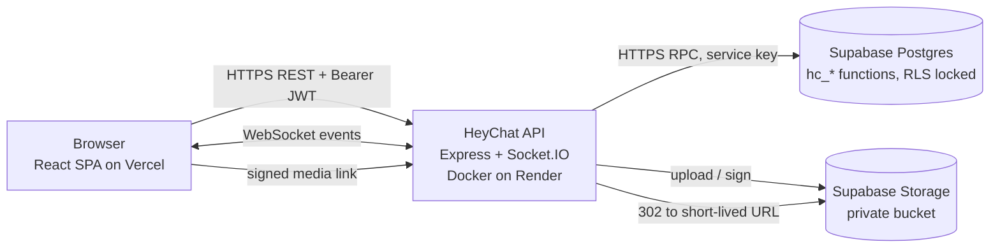

# HeyChat

A real-time, one-to-one messenger for text, photos and voice notes. It works on phones, tablets and desktops.

- **Frontend:** React 19 + TypeScript + Vite, deployed on Vercel. Earthy palette (cream #FAF8F5, sage #4A6B5D, ochre #D9A05B), Plus Jakarta Sans variable font
- **Backend:** Node.js + Express 5 + Socket.IO + TypeScript, deployed as a Docker web service on Render
- **Data:** Supabase Postgres (all logic in SQL functions) and Supabase Storage (private bucket)



## Features

- Accounts with username + password, profile name, bio and photo
- Find people by username and start a private chat
- Real-time delivery over WebSockets with automatic reconnect and catch-up
- Sent, delivered and read ticks; typing indicator; online and last-seen presence
- Photos with caption, blurred placeholder while loading, full-screen viewer, paste-to-send
- Voice notes: record in the browser, live level meter, waveform playback with seeking and 1x/1.5x/2x speed
- Reply to a message, edit within 15 minutes, delete for everyone, emoji reactions
- Unread counts, unread divider, infinite scroll history, per-chat drafts, offline retry for failed sends
- Block and unblock, clear chat for yourself, delete account (removes all of your data and files)
- Desktop notifications (opt-in), installable as a PWA, light and dark themes, keyboard and screen-reader friendly

## Security

| Area | What is done |
| --- | --- |
| Passwords | Argon2id (OWASP parameters). Unknown usernames take the same time to fail as wrong passwords. |
| Sessions | 15-minute HS256 access tokens + 30-day opaque refresh tokens stored as SHA-256 hashes. Refresh tokens rotate on every use, and **reusing an old one revokes the whole session family** (theft detection). Tabs coordinate refreshes with the Web Locks API. |
| Revocation | "Sign out everywhere" and password changes bump a token version, so outstanding access tokens stop working within a minute and live sockets are disconnected. |
| Authorization | Every conversation and message operation checks membership inside the database function itself. A user who is not in a chat gets `404`, not `403`, so chat IDs cannot be probed. |
| Database | RLS enabled on every table with no policies, and no grants for the `anon` / `authenticated` roles. The browser never talks to Supabase. Only the backend does, with the service key. |
| Media | Uploads are type-checked by magic bytes, not by name or MIME header. Images are re-encoded to WebP (strips EXIF/GPS). Voice notes are transcoded to MP3 with ffmpeg, and the server measures duration and waveform itself. Files sit in a private bucket and are only reachable via HMAC-signed links that expire. |
| Transport | Helmet security headers, strict CORS allowlist (REST and WebSocket), HSTS, CSP on the frontend, `frame-ancestors 'none'`. |
| Abuse | Rate limits per IP (auth) and per user (send, upload, search); a token bucket on socket events; body size limits; zod validation on every input. |
| Secrets | Only `SUPABASE_URL` and `SUPABASE_SERVICE_ROLE_KEY` are needed. JWT and media-link keys are derived with HKDF (domain separated), or from `APP_SECRET` if you set one. No secrets ship to the browser. |

## Repository layout

```
backend/    Express + Socket.IO API (TypeScript) and its Dockerfile
frontend/   React SPA (TypeScript, Vite), vercel.json with security headers
supabase/   schema.sql: tables, indexes, RLS lockdown, hc_* functions, storage bucket
.github/    CI: API tests against real Postgres, frontend build, dependency audit
render.yaml Render Blueprint for the API service
```

## Running locally

Requirements: Node 20+, PostgreSQL 15+, ffmpeg.

```bash
# 1. Database: create a database and apply the schema
createdb heychat
psql heychat -c "create role anon; create role authenticated; create role service_role;"
psql heychat -f supabase/schema.sql

# 2. API
cd backend && npm ci
DATABASE_URL=postgres://localhost/heychat npm run dev        # http://localhost:7860

# 3. Web app
cd ../frontend && npm ci
VITE_API_URL=http://localhost:7860 npm run dev               # http://localhost:5173
```

Without Supabase variables, the API stores files on local disk (`LOCAL_STORAGE_DIR`).

Tests (22 end-to-end API tests against a real Postgres and real ffmpeg/sharp):

```bash
cd backend && TEST_DATABASE_URL=postgres://localhost/heychat_test npm test
```

## Deploying

1. **Supabase:** create a project, open the SQL editor, run `supabase/schema.sql`.
2. **Render:** New > Blueprint, pick this repo. `render.yaml` creates the `heychat-api` Docker service (free plan). Enter `SUPABASE_SERVICE_ROLE_KEY` (Supabase > Project Settings > API keys) and `CORS_ORIGINS=https://<your-app>.vercel.app` when asked. Every push to `main` redeploys.
3. **Vercel:** import this repo with **Root Directory = `frontend`**. `VITE_API_URL` is read from `frontend/.env.production`. Change it if your Render service has a different URL, and update the CSP `connect-src` in `frontend/vercel.json` to match.

Render's free plan puts the API to sleep after 15 minutes without traffic. The first request after that wakes it (about a minute), and the sign-in page shows a message while it does. Hugging Face was the original target, but Docker Spaces now require a paid plan.

## API overview

| Method | Path | Purpose |
| --- | --- | --- |
| POST | `/api/auth/register`, `/api/auth/login` | Create account / sign in |
| POST | `/api/auth/refresh`, `/api/auth/logout`, `/api/auth/logout-all` | Session lifecycle |
| POST | `/api/auth/change-password` | Change password (signs out other devices) |
| GET | `/api/auth/me` | Current user |
| GET | `/api/users/search?q=` | Find people |
| PATCH | `/api/users/me` | Update name and bio |
| POST/DELETE | `/api/users/me/avatar` | Set or remove profile photo |
| POST | `/api/users/me/delete` | Delete account (password required) |
| POST/DELETE | `/api/users/:id/block` | Block / unblock |
| GET/POST | `/api/conversations` | List chats / open a chat with a user |
| GET | `/api/conversations/:id/messages?before=&limit=` | History (cursor pagination) |
| POST | `/api/conversations/:id/messages` | Send text (idempotent via `clientId`) |
| POST | `/api/conversations/:id/media` | Send photo or voice note (multipart) |
| POST | `/api/conversations/:id/read`, `/clear` | Mark read / clear for me |
| PATCH/DELETE | `/api/messages/:id` | Edit / delete for everyone |
| PUT | `/api/messages/:id/reaction` | React or remove reaction |

Socket events from the server: `message:new`, `message:updated`, `receipt`, `typing`, `presence`, `user:updated`, `user:deleted`.
From the client: `typing`, `delivered`.

## License

MIT
